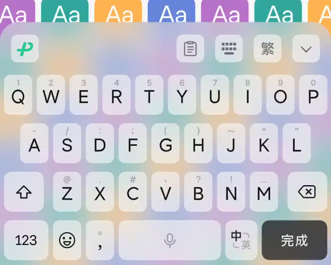
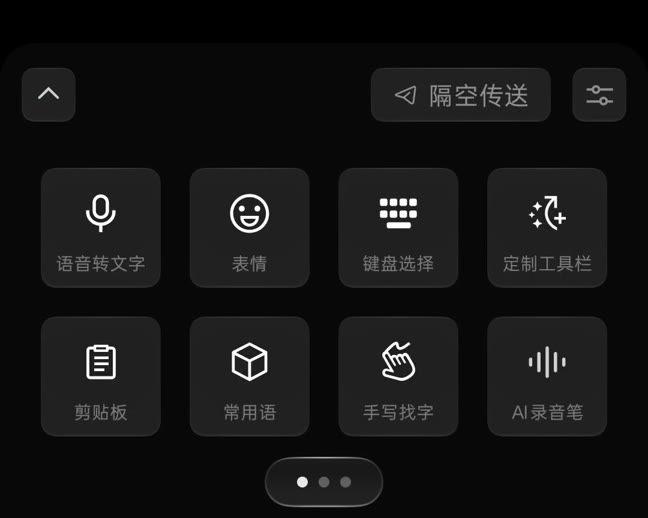

# 微信输入法凝光 · WeType-COUI

面向 ColorOS 17 的 LSPosed 模块，为微信输入法添加 COUI 按键、毛玻璃底板和跟手拖拽。输入、候选和剪贴板操作由微信输入法处理。

| 浅色键盘 | 深色功能面板 |
| --- | --- |
|  |  |

## 功能

- 键盘、候选栏和内嵌面板共用一层系统模糊，支持深浅色。系统窗口模糊关闭时采用对应主题的底色。
- 按键、功能卡和分段控件使用 COUI 的圆角与拖拽反馈。长按菜单、数字键盘符号栏和表情分类支持滑动选择。
- 剪贴板与常用语共用玻璃卡片。左上角功能面板进出带横向转场，数字、表情和其他键盘页面直接切换。

## 安装

| 项目 | 已验证的配置 |
| --- | --- |
| 模块版本 | 0.4.5（30） |
| 手机系统 | ColorOS 17 |
| 输入法 | 微信输入法 4.0.1（版本码 `59201`，包名 `com.tencent.wetype`） |
| 框架 | 支持现代模块 API 101 或以上的 LSPosed 环境 |

1. 请通过官方渠道单独安装所需版本的微信输入法。
2. [从源码构建](BUILD.md)并安装生成的凝光模块 APK。
3. 在 LSPosed 管理器中启用「微信输入法凝光」，作用域勾选「微信输入法」。
4. 停止微信输入法进程，再打开输入框。如果系统改用了其他输入法，在系统设置里重新选择微信输入法。

如果键盘样式没有变化，先核对输入法版本码和 LSPosed 作用域。恢复原样时，在 LSPosed 中停用模块并重启输入法进程。

## 开发与许可

[本地构建、代码入口与验收](BUILD.md) · [MPL-2.0](LICENSE) · [许可范围与第三方署名](NOTICE.md)

微信输入法凝光是独立开发的社区模块。COUI-Kit 和 suqi8/coui 是代码和设计参考来源。相关产品名称和标识用于说明兼容性及来源，权利归各自所有者。
